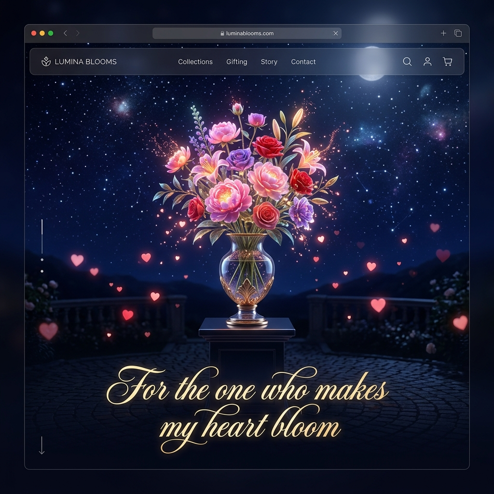

# 🌸 Interactive Romantic Bouquet 💖

An immersive, premium digital greeting card featuring blooming 3D flowers, real-time custom audio synthesis, dynamic particle physics, and a luxurious interactive gift overlay.

Live Demo: **[colorfulhearts1.netlify.app](https://colorfulhearts1.netlify.app/)**

---

## 📸 Demo Preview



---

## ✨ Features

- 💌 **Interactive Gift Overlay**: Welcomes the recipient with an elegant glassmorphism card, a pulsing heart, and a glowing "Open Gift" button. Clicking this triggers a smooth transition that dissolves the overlay and begins the blooming sequence.
- 🎹 **Real-time Web Audio API Synthesizer**: Generates a sweet, nostalgic music box melody (a slow, resonant arpeggiated C-G-Am-F chord progression) dynamically in the browser, bypassing the need for external MP3 files. Includes an audio toggle button (`🔊` / `🔇`) to mute/unmute at any time.
- 🎨 **Dynamic Flower Color-Cycling**: Hovering over a flower top scales it up with a custom colored glow. Clicking the flower top cycles its colors through 7 curated shades:
  - **Pink** ➔ **Red** ➔ **White** ➔ **Purple** ➔ **Orange** ➔ **Yellow** ➔ **Cyan**
- 🔔 **Tactile Audio Feedback**: Clicking a flower top plays a localized, high-pitched melodic chime tone (forming a beautiful chord sequence) and triggers a burst of matching colored heart particles.
- 🌹 **Dual-Particle System**: Combines falling, wind-swayed **3D red rose petals** drifting from the sky with **glowing pink hearts** rising gently from the ground.
- 🌌 **Twinkling Starry Night**: Dynamically populates the dark backdrop with twinkling stars of randomized sizes, locations, and blink intervals.

---

## 🛠️ Technology Stack

- **Markup**: Semantic HTML5 structures.
- **Styling**: Vanilla CSS3 featuring custom properties (variables), 3D perspectives, custom timing functions, and keyframe animations.
- **Programming**: Vanilla ES6+ JavaScript.
- **Audio Engine**: Web Audio API (native oscillators and exponential gain envelope shaping).
- **Hosting**: Netlify.

---

## 📂 File Structure

```text
├── index.html       # DOM structure containing the card, caption, and flowers
├── style.css        # Interactive styling, transitions, variables, and particle effects
├── script.js        # Web Audio sequencer, particle generators, and event listeners
└── demo.png         # Screenshot preview of the active application
```

---

## 🚀 Getting Started

### Local Setup
Since the application uses pure vanilla technologies without dependencies, you can run it instantly:

1. Clone or download the repository.
2. Open [index.html](./index.html) directly in any modern web browser (Chrome, Safari, Edge, Firefox).
3. Alternatively, run a local web server (e.g., VS Code's Live Server or Python's `http.server`):
   ```bash
   python -m http.server 8000
   ```
   Navigate to `http://localhost:8000`.

---

## 💡 Developer Details

Refactored with **resilient execution patterns**:
- **Defensive Audio Architecture**: Web Audio API context construction is wrapped inside strict `try...catch` blocks. If a browser restricts AudioContext (e.g., due to sandboxed contexts or custom autoplay blocking), the visual animation and color-cycling continue to load and run seamlessly without crashes.
- **Immediate Dom Execution**: Script logic executes immediately on document readiness checks rather than waiting for external network asset callbacks, preventing load freezes on slow connections.
